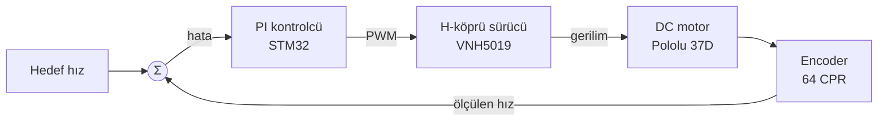
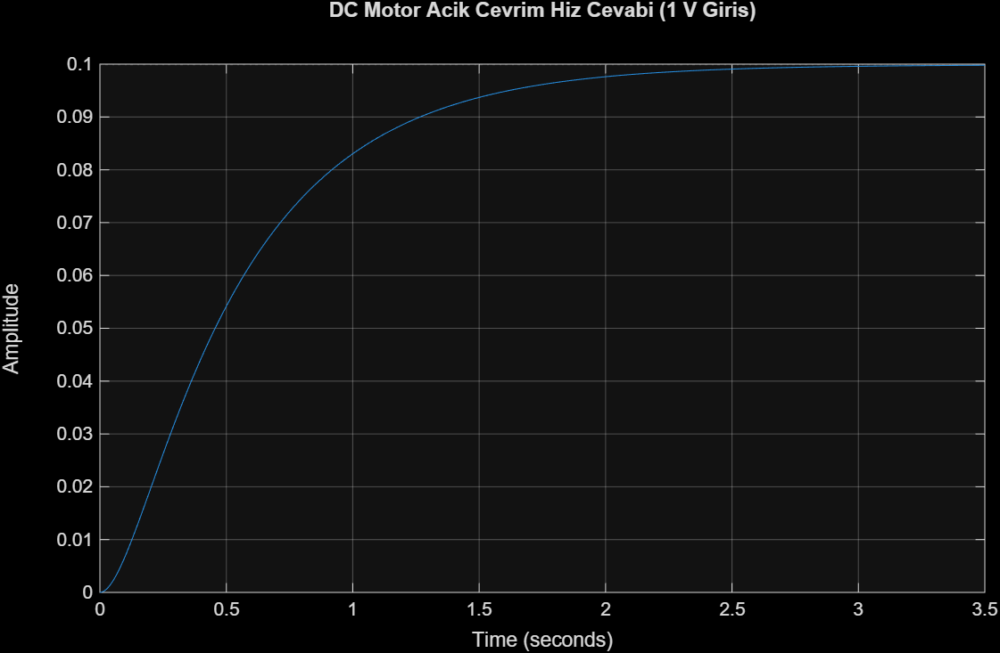
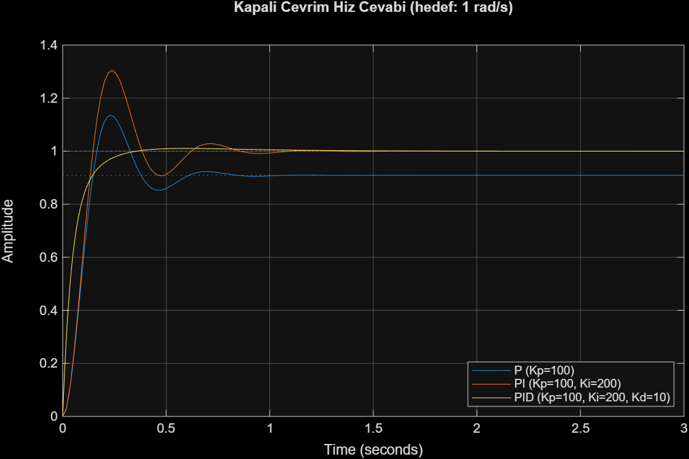
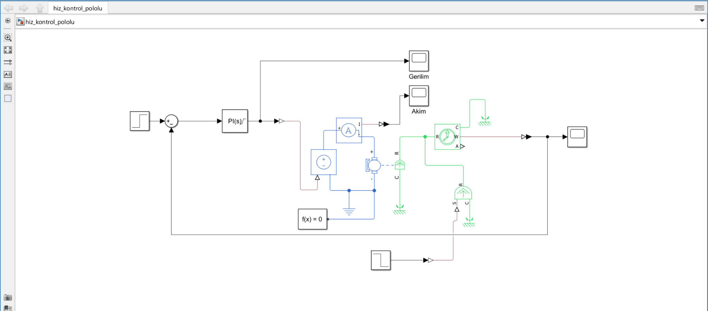
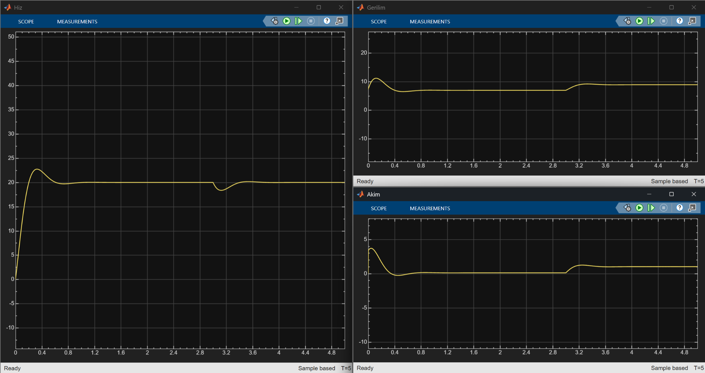
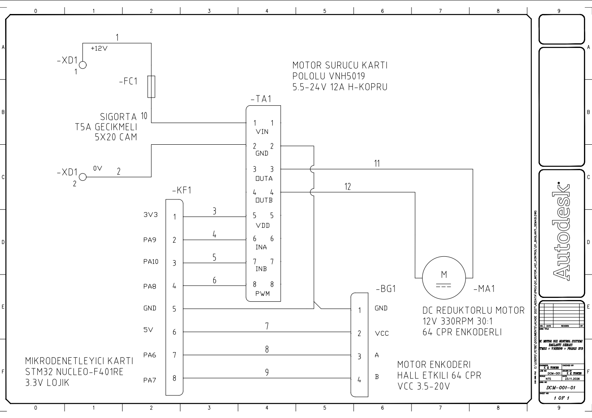

# DC Motor Hız Kontrol Sistemi — Modelleme, PID Tasarımı ve Elektrik Şeması

Encoder'lı bir DC redüktörlü motorun hızını kapalı çevrimde kontrol eden bir sistemin uçtan uca mühendislik çalışması: matematiksel model, PID tasarımı, fiziksel (Simscape) simülasyon, gerçek motor datasheet'inden parametre çıkarımı ve IEC 81346 standardında bağlantı şeması + malzeme listesi.

**Araçlar:** MATLAB · Simulink · Simscape Electrical · Control System Toolbox · AutoCAD Electrical

---

## Sistem Özeti



| Bileşen | Seçim | Gerekçe |
|---|---|---|
| Motor | Pololu 37D, 12 V, 30:1, 64 CPR encoder | Datasheet'i modelleme için yeterli veri veriyor, encoder entegre |
| Sürücü | Pololu VNH5019 (5.5–24 V, 12 A) | Motorun kilitli rotor akımının (5.5 A) üzerinde sürekli akım kapasitesi |
| Mikrodenetleyici | STM32 NUCLEO-F401RE | Donanım PWM (TIM1) ve donanım encoder arayüzü (TIM3) |
| Koruma | T5A gecikmeli sigorta | Kalkış akımında (3.7 A) atmaz, kilitli rotorda (5.5 A) atar |

---

## Klasör Yapısı

```
├── matlab/
│   ├── motor_parametreleri.m    # Ders kitabı motor modeli, açık çevrim analizi
│   ├── pid_tasarim.m            # P / PI / PID karşılaştırması
│   └── motor_pololu.m           # Datasheet'ten parametre çıkarımı + pidtune
├── simulink/
│   ├── hiz_kontrol.slx          # Transfer fonksiyonu ile kapalı çevrim
│   ├── hiz_kontrol_simscape.slx # Fiziksel model (kaynak, motor, sensör)
│   └── hiz_kontrol_pololu.slx   # Gerçek motor + 12 V doyma + yük testi
├── elektrik/
│   ├── DCM-001-01_Baglanti_Semasi.pdf
│   ├── DCM-001-01_Baglanti_Semasi.dwg
│   └── DCM-001_BOM.xls
└── images/
```

## Nasıl Çalıştırılır

1. MATLAB'da depo klasörünü açın, `matlab` ve `simulink` klasörlerine sağ tıklayıp **Add to Path → Selected Folders** seçin.
2. Simulink modelleri parametreleri MATLAB çalışma alanından okur. Önce ilgili scripti çalıştırın:
   - `hiz_kontrol.slx` ve `hiz_kontrol_simscape.slx` → `motor_parametreleri.m`
   - `hiz_kontrol_pololu.slx` → `motor_pololu.m` (motor parametreleri ve `C` kontrolcüsü)
3. Modeli açıp **Run** ile çalıştırın.

---

## 1. DC Motor Modeli

Motor, birbirine bağlı iki denklemle modellendi:

- **Elektriksel:** `V = R·i + L·di/dt + K·ω` (son terim zıt EMK)
- **Mekanik:** `J·dω/dt + b·ω = K·i` (sol taraf atalet ve sürtünme, sağ taraf motor torku)

Laplace dönüşümüyle gerilimden hıza transfer fonksiyonu:

```
G(s) = K / [(J·s + b)(L·s + R) + K²]
```

Açık çevrim analizinde (ders kitabı parametreleri) sistemin aşırı sönümlü olduğu (kutuplar ≈ −2 ve −10), 1 V girişte yalnızca 0.1 rad/s hıza ulaştığı ve ~2 s'de yerleştiği görüldü. Hedef hızı tutmak ve yük değişimlerine karşı koymak için kapalı çevrim kontrol gerekli.



---

## 2. P, PI ve PID Karşılaştırması

| Kontrolcü | Aşım | Yerleşme | Kalıcı hata |
|---|---|---|---|
| P (Kp=100) | %24.9 | 0.57 s | 0.091 |
| PI (Kp=100, Ki=200) | %30.5 | 0.77 s | 0 |
| PID (Kp=100, Ki=200, Kd=10) | %1.0 | 0.26 s | 0 |

- **P** kalıcı hata bırakıyor: motorun dönmeye devam etmesi için sürekli gerilim gerekiyor, P ise ancak hata varken gerilim üretiyor. Sistem hata ≈ 0.09'da dengeye oturuyor.
- **I** geçmiş hatayı biriktirerek kalıcı hatayı sıfırlıyor, ancak aşımı artırıyor.
- **D** hata değişim hızına tepki vererek aşımı bastırıyor.



---

## 3. Fiziksel Model ve Gerçekçi Sınırlar (Simscape)

Transfer fonksiyonu bloğu; kontrollü gerilim kaynağı, DC motor, hız sensörü ve akım sensöründen oluşan bir Simscape devresiyle değiştirildi. Aynı parametrelerle aynı hız cevabı elde edilerek **model doğrulandı.**



### Bulgu: Kâğıt üstünde mükemmel, gerçekte imkânsız

Hız cevabı ideal görünürken gerilim ve akım incelendiğinde:

- Kontrolcü t=0'da **~1100 V** talep ediyor (türev tekmesi: basamak referansta D teriminin ani tepkisi)
- Akım **18.5 A**'e sıçrıyor

12 V'luk bir sürücü bunu üretemez. **Çözüm:** PID çıkışına ±12 V doyma sınırı ve **clamping anti-windup** eklendi. Sonuç: gerilim 12 V'u aşmıyor, yerleşme süresi 0.26 s → ~1.6 s. Bu fark kontrolcünün değil donanımın sınırıdır; daha hızlı cevap için daha güçlü bir motor veya daha yüksek gerilimli sürücü gerekir.

### Yük bozucusuna karşı davranış

Kararlı haldeyken motor miline basamak yük torku uygulandı. Hız kısa süre düştü ve kontrolcü gerilimi artırarak hızı hedefe geri getirdi (bozucu etki bastırma). Kalıcı ek gerilimi integral terim sağlıyor. Açık çevrimde aynı yük kalıcı ~%10 hız kaybına yol açardı.

---

## 4. Gerçek Motor: Datasheet'ten Model

Ders kitabı parametreleri gerçekçi değildi (1 rad/s için 100 W). Pololu 37D 12 V 30:1 motorun datasheet değerlerinden parametreler türetildi:

| Datasheet | Değer |
|---|---|
| Boşta hız @12 V | 330 rpm |
| Boşta akım | 0.2 A |
| Kilitli rotor akımı | 5.5 A |
| Kilitli rotor torku | 14 kg·cm (1.37 N·m) |

| Parametre | Yöntem | Sonuç |
|---|---|---|
| R | V / I_kilitli (zıt EMK = 0) | 2.18 Ω |
| K | (V − R·I_boşta) / ω_boşta | 0.335 V·s/rad |
| b | K·I_boşta / ω_boşta | 0.00194 N·m·s/rad |
| L | Tahmin (bu boyut için tipik) | 2 mH |
| J | Tahmin (motor + dişli + küçük yük) | 0.01 kg·m² |

**Doğrulama:** Model boşta hızı 330 rpm ile birebir veriyor.

**Bulgu — dişli kutusu verimi:** Model kilitli torku 1.84 N·m hesaplarken datasheet 1.37 N·m veriyor. Fark dişli kutusu kayıplarından kaynaklanıyor: verim ≈ **%75**.

### Kontrolcü

MATLAB `pidtune` ile **PI** kontrolcü tasarlandı: **Kp = 0.363, Ki = 5.72**. D terimi kullanılmadı; encoder ölçümündeki gürültüyü büyütür ve bu sistemde gereksiz frenleme yapar (bkz. Hata Ayıklama).

### Sonuçlar (hedef 20 rad/s ≈ 190 rpm, t=3 s'de 0.3 N·m yük)

| | Yüksüz | Yüklü |
|---|---|---|
| Hız | 20 rad/s (~0.8 s'de yerleşme, ~%13 aşım) | 18.4'e düşüp ~0.5 s'de 20'ye dönüyor |
| Gerilim | ~7 V | ~8.9 V |
| Akım | ~0.1 A | ~1.0 A |

- **En yüksek gerilim 11.2 V** → 12 V kaynak yeterli, doymaya girmiyor
- **Kalkış akımı 3.7 A** → sürücü ve sigorta seçimi bu değere göre yapıldı

Simülasyonda hesapla öngörülen kararlı hal değerleri (7→9 V, 0.1→1 A) ile simülasyon sonuçları örtüşüyor.



---

## 5. Elektrik Bağlantı Şeması (AutoCAD Electrical)

IEC 81346 standardında etiketlenmiş tek sayfa bağlantı şeması. Kablo numaraları ile tüm netler doğrulandı.



| Net | Bağlantı | Görev |
|---|---|---|
| 1 | -XD1:1 → -FC1 | +12 V giriş |
| 10 | -FC1 → -TA1 VIN | Sigortalı +12 V |
| 2 | -XD1:2 → -TA1 GND → -KF1 GND → -BG1 GND | **Ortak toprak** |
| 11, 12 | -TA1 OUTA/OUTB → -MA1 | Motor gücü |
| 3 | -KF1 3V3 → -TA1 VDD | Sürücü lojik beslemesi |
| 4, 5 | -KF1 PA9/PA10 → -TA1 INA/INB | Yön |
| 6 | -KF1 PA8 (TIM1) → -TA1 PWM | Hız komutu (kontrolcü çıkışı) |
| 7 | -KF1 5V → -BG1 VCC | Encoder beslemesi (min. 3.5 V) |
| 8, 9 | -BG1 A/B → -KF1 PA6/PA7 (TIM3) | Hız ölçümü (geri besleme) |

**Malzeme listesi (BOM)** katalog verilerinden otomatik üretildi: `elektrik/DCM-001_BOM.xls`. BOM, şemadaki ana bileşenleri kapsar; adaptör, sigorta yuvası, klemens bloğu ve kablolar dahil değildir.

---

## Hata Ayıklama ve Öğrenilenler

Projede karşılaşılan ve çözülen gerçek sorunlar:

1. **İmkânsız kontrol sinyali (1100 V):** Yalnızca hız grafiğine bakmak yetersiz; gerilim ve akım da izlenmeli. Çözüm: doyma + anti-windup.
2. **Unutulan D terimi:** Gerçek motora geçerken PID bloğunda eski D=10 kalmıştı. Belirtiler: t=0'da ±12 V iğne, hızın yavaş artıp hedefi 29 rad/s'ye kadar aşması, gürültü benzeri sıçramalar. Grafiklerden geriye doğru akıl yürütülerek kök neden bulundu.
3. **Bağlanmamış kablo:** Şemada bağlı görünen bir kablo, kablo numaralandırmasında aynı nette iki farklı numara alarak tespit edildi.
4. **Yanlış karta bağlanan encoder:** İki taraflı konnektörde pinin her iki tarafının aynı net olduğu gözden kaçınca encoder sürücünün sinyal hatlarına bağlanmıştı (3V3–GND kısa devresine yol açacaktı). Yine kablo numaraları ile yakalandı.
5. **BOM çift sayımı:** Encoder ve motor aynı katalog numarasını taşıdığı için motor 2 adet görünüyordu; encoder'ın katalog bilgisi kaldırılarak düzeltildi.

---

## Varsayımlar ve Sınırlamalar

- L ve J datasheet'te verilmediği için tahmin edildi; gerçek motorda ölçülerek (ör. yavaşlama testi) doğrulanmalı.
- Dişli boşluğu (backlash), sürtünmenin doğrusal olmayan kısmı ve encoder çözünürlüğü modellenmedi.
- Kontrolcü sürekli zamanda tasarlandı; mikrodenetleyiciye aktarımda ayrıklaştırma (örnekleme süresi seçimi) gerekecek.

## Sonraki Adımlar

- [ ] STM32 üzerinde PWM, encoder okuma ve ayrık zamanlı PI kontrolcü yazılımı
- [ ] Gerçek motorla ölçüm ve simülasyon sonuçlarıyla karşılaştırma
- [ ] Simulink modelinden otomatik kod üretimi (Embedded Coder) denemesi

---

**Hazırlayan:** Yunus Emre Tuncer — Elektrik-Elektronik Mühendisi
